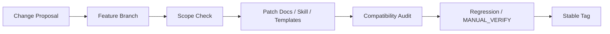

# 管线演进规则

> v1.11-office-onboarding-stable · 如何安全地演进 Hermes Workline

## Contribution Principles

1. **Preserve v1.10 canonical baseline.** 不推翻 Intake / AUTO-BLOCK / Coverage / Experience Injection。
2. **Preserve v1.11 Office safety layer.** 不改动 safe-note / office-lite / full-harness / personal-lab 的语义边界。
3. **Do not bypass safety gates.** 任何修改都不得绕过 Company Policy / Sensitive Data / Action Permission / Persistence / Mode Switch Gate。

## Change Flow



## Skill Sync Rule

```
1. 修改 SKILL.md 必须开分支
2. 修改前确认 repo skill 与 runtime skill 一致
3. 不能只改 runtime skill 不回写 repo
4. 不能只改 repo skill 不同步 runtime
5. 修改后必须执行兼容性审计
6. 发现 runtime→repo 分裂 → 先做 baseline sync
```

**GAP #4 教训**：v1.8/v1.9/v1.10 曾出现 runtime skill 更新但 repo 停留 v1.7 的问题。以后任何 skill 规则升级，repo 和 runtime 必须同步。

同步命令：

```bash
# Do not run blindly. Check repo diff, confirm runtime target path,
# back up runtime skill if needed, then re-run compatibility audit.
cp -r skills/<name> ~/AppData/Local/hermes/skills/<name>/
```

## Office Mode Rule

任何涉及以下内容的改动，都必须更新 `regression/office_onboarding/` 回归用例：

- safe-note / office-lite / full-harness / personal-lab
- Company Policy / Sensitive Data / Action Permission / Persistence / Mode Switch Gate
- Codex 权限边界
- ChatGPT 信息流规则
- Obsidian 工作 Vault 保存规则

## MANUAL_VERIFY Rule

`regression/office_onboarding/` 下的用例全部标记为 `[MANUAL_VERIFY]`：

- 不能伪装成自动化测试通过
- 未来自动化需单独设计 checker，不得直接改状态
- 每次涉及 Office Mode/Gate 的改动后必须手动验证

## Release Rule

稳定版本必须具备：

| 条件 | 检查方式 |
|:---|:---|
| final audit PASS | `reports/vX.YY/phase9_final_audit.md` |
| release notes | `reports/vX.YY/vX.YY_*_release_notes.md` |
| git status clean | `git status --short` |
| stable tag | `git tag vX.YY-stable` |
| 零敏感信息 | Phase 9 敏感信息扫描 |
| CI pass | `python tests/harness_check/run_harness_check_cases.py` |

## Prohibited Actions

```
不允许绕过 Company Policy Gate
不允许绕过 Sensitive Data Gate
不允许把公司内容写入 reports / docs / templates
不允许让 Codex 默认接触公司项目
不允许让 ChatGPT 接收公司源码或内部文档
不允许空建 future-only 目录（observability/ 等）
```

## Stable Version History

- `v1.11-office-onboarding-stable` — 4 modes, 5 gates, 6 templates
- `v1.9-stable` — CI + Regression 10/10
- `v1.8-stable` — Harness Checker
- `v1.7-stable` — Workline Core
