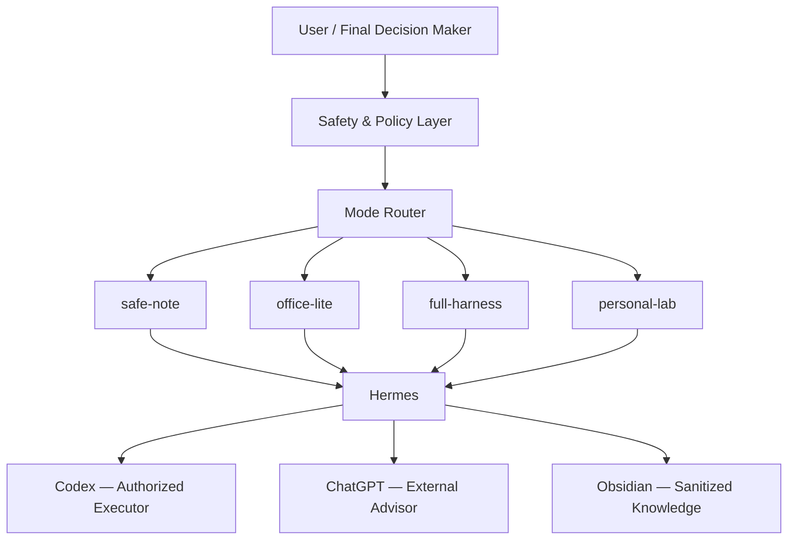
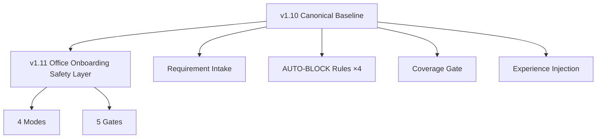
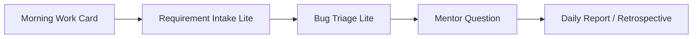

# Hermes Harness Workline

> Personal Agent Engineering Workline with Safe Office Onboarding.


---

## Current Stable Version

```
v1.11-office-onboarding-stable
```

## What This Is

一个**个人 Agent Engineering / SDD-Harness 工作线**——用于结构化任务执行、需求拆解、审查、复盘、经验注入，以及公司入职场景下的安全合规辅助。

它不是公司工具，不是自动化开发替代品。它是一个帮助你安全、结构化地工作的个人管线。

## System Overview



## Version Architecture



## Modes

| Mode | Trigger | What You Can Do |
|:---|:---|:---|
| **safe-note** | Company policy unknown | Sanitized notes, question templates, daily reports |
| **office-lite** | Company allows personal notes | + Requirement breakdown, impact analysis (no code access) |
| **full-harness** | Company + user authorized | Full v1.10 pipeline (authorized directories only) |
| **personal-lab** | Personal projects | Full v1.10 pipeline (no safety limits) |

## Gates

| Gate | Purpose |
|:---|:---|
| **Company Policy Gate** | Unknown policy → `safe-note` by default |
| **Sensitive Data Gate** | Auto-redact source code/paths/class names before output |
| **Action Permission Gate** | 6-level action control — L6 (commit/push) always blocked |
| **Persistence Gate** | Block saving company data to files, Obsidian, or memory |
| **Mode Switch Gate** | Work / Learn / Think line switching requires manual confirmation |

## Daily Usage Flow



## Start Here

| Document | Purpose |
|:---|:---|
| `docs/INDEX.md` | Full documentation index |
| `docs/OFFICE_ONBOARDING_FIRST_WEEK_SOP.md` | Day 1–5 onboarding roadmap |
| `docs/OFFICE_ONBOARDING_DAILY_USAGE_GUIDE.md` | Daily workflow guide |
| `docs/OFFICE_ONBOARDING_WORKLINE_V1.11.md` | v1.11 design rationale |
| `docs/OBSIDIAN_WORK_VAULT_SAFE_STRUCTURE.md` | Vault safety rules |

## Safety Notice

**Before company policy is confirmed:**

- ❌ Do not scan company project directories
- ❌ Do not read company source code
- ❌ Do not let Codex modify company code
- ❌ Do not send company details to ChatGPT
- ❌ Do not persist company-sensitive information

**Default mode in company context: `safe-note`.**

## Repository Status

```
stable tag:  v1.11-office-onboarding-stable
baseline:    v1.10 canonical (Intake / AUTO-BLOCK ×4 / Coverage / Experience Injection) — restored
office:      v1.11 Office Onboarding safety layer (4 modes, 5 gates) — active
regression:  office_onboarding cases (6) — MANUAL_VERIFY
audit:       Phase 0 → Phase 9 — complete chain
```
