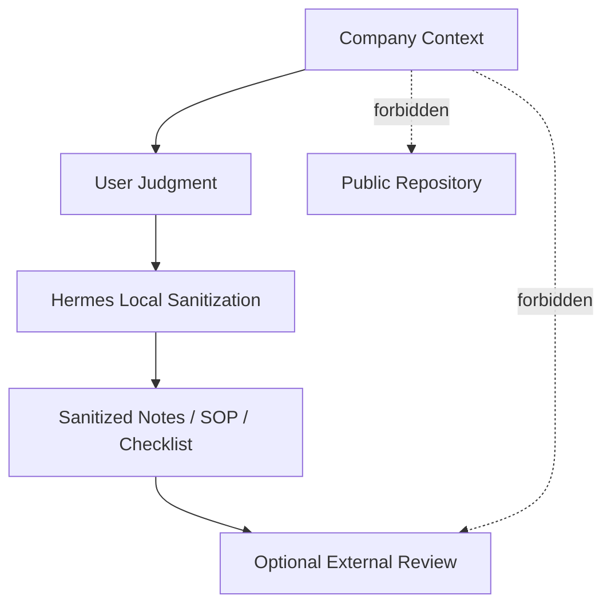

# Security Policy

> v1.11-office-onboarding-stable · Office Onboarding Security Model

## Scope

本仓库的安全目标：保护个人仓库、Hermes 工作线、Office Onboarding 使用场景中的敏感信息边界。本策略不替代公司安全政策。

## Secrets

以下内容**永远不进入仓库**：API Key / Token / Secret / 服务端 IP / 数据库连接串 / `.env`。

---

## Office Onboarding Security Model

### Default Rule

```
Company Policy Gate = UNKNOWN → safe-note
```

公司规范未确认时，默认进入 safe-note。仅允许脱敏笔记、提问话术、日报模板。

### Data Flow Boundary



---

## Forbidden Data

以下内容**永远不进入本仓库、Obsidian 工作 Vault、或任何持久存储**：

- 公司源码
- 内部路径
- 内部类名 / 方法名
- 协议名 / 字段名
- 配置字段
- 资源名 / Prefab 名
- 服务器地址
- 账号 / Token / Key
- 未公开玩法 / 活动 / 数值
- 具体 Bug 单内容
- 内部文档原文

---

## Tool Boundaries

### Hermes

| 允许 | 禁止 |
|:---|:---|
| 方案分析、任务拆解 | 未授权扫描公司项目 |
| 生成提问话术、日报模板 | 未授权读取公司源码 |
| 脱敏复盘、checklist、SOP | 未授权修改公司文件 |
| 通用技术概念解释 | 自动外发公司内容 |

### Codex

```
Codex is an authorized-only executor.
```

- 公司规范未确认 → 不调用 Codex 处理公司代码
- 公司规范 = ALLOWED_NOTE → 不调用 Codex
- 公司规范 = ALLOWED_AGENT + 用户显式授权 → 允许在授权范围内执行
- personal-lab → 无限制

### ChatGPT / External LLMs

**只接收脱敏后的抽象问题和方案。**

不得发送：公司源码、内部文档、具体 Bug 描述、具体需求内容、内部协议/配置/资源。

---

## Obsidian Work Vault

工作 Vault 只能保存抽象经验、SOP、checklist、提问模板、脱敏日报。不能保存公司具体实现。

详见 `docs/OBSIDIAN_WORK_VAULT_SAFE_STRUCTURE.md`。

---

## Git Guardrails

禁止 `git push --force` / `git reset --hard` / `git clean -fd`。

---

## Incident Handling

1. 立即停止当前提交
2. 不在日志中输出原文
3. 记录文件路径和敏感信息类型
4. 清理后重新审计
5. 重写 git 历史需用户确认
